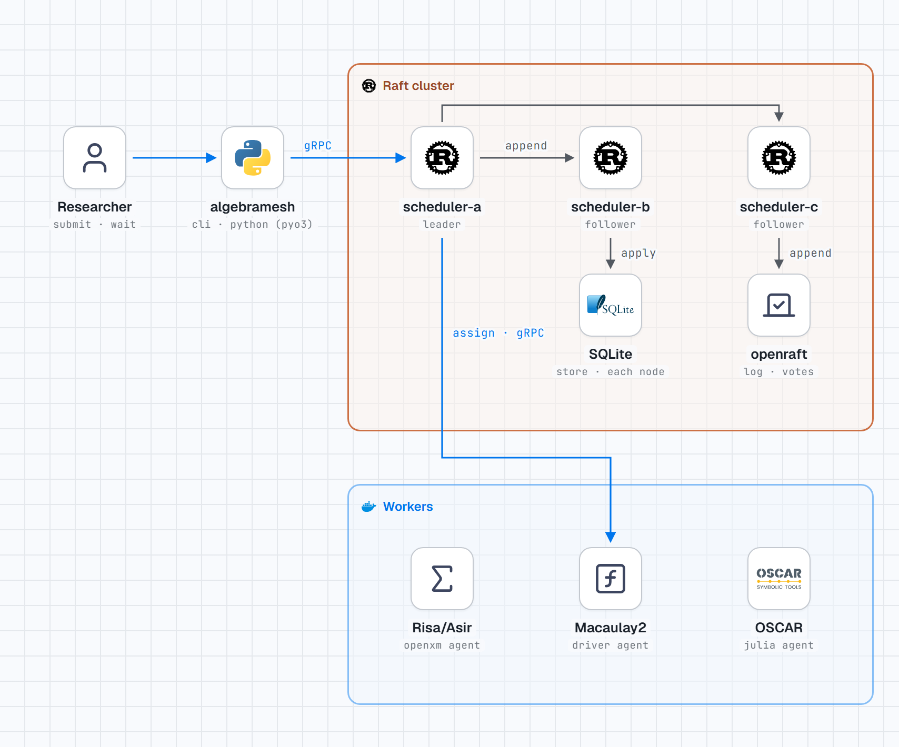

# AlgebraMesh

Rust-based distributed computer algebra and research computing platform.

AlgebraMesh は, 複数ホスト上の計算資源と複数の Computer Algebra System (CAS) を, 型付き・非同期・再現可能な形で使うための基盤である.
数式処理アルゴリズムは Rust で再実装しない.
Rust が担当するのは通信, プロセス隔離, スケジューリング, 型付きデータの受け渡し, 記録と検証である.

- 設計: [docs/design.md](docs/design.md)
- 構築と運用: [docs/install.md](docs/install.md)
- 実装時に確認・決定した事項: [docs/adr/](docs/adr/)
- 性能測定: [docs/benchmarks.md](docs/benchmarks.md)
- ライセンス調査: [docs/licenses.md](docs/licenses.md)
- 変更履歴: [CHANGELOG.md](CHANGELOG.md)

文書とコードの中の `#108` までの Issue 番号と commit (`05720d5` など) は, 公開前の非公開の履歴のものである. このリポジトリの Issue と commit とは別である.

## Risa/Asir の利用条件

- Asir backend を使うジョブと `agent-asir` イメージは, Risa/Asir の LIMITED USE LICENSE AGREEMENT に従う. 使用, 複製, 再配布は非営利・非営業の目的に限られ, 商用の許諾はない.
- Asir backend で得た結果を論文や発表に使うときは, Risa/Asir とその著作権者を参照する.
- AlgebraMesh 自体 (scheduler, agent, client) と, Macaulay2 と OSCAR の backend にはこの制約はない. 商用の目的では, Asir の worker を置かずに使う.
- 詳細は [docs/licenses.md](docs/licenses.md) の §3 にある.

<picture>
  <source media="(prefers-color-scheme: dark)" srcset="docs/images/architecture-dark.png">
  
</picture>

構成図は [stack-diagram](https://github.com/caru-ini/stack-diagram) で作った (元の HTML は [docs/images/architecture.src.html](docs/images/architecture.src.html)). ロゴは svgl, Lucide, OSCAR のリポジトリから取得したもので, 各ブランドの商標である.

## できること

| 機能 | 内容 |
|---|---|
| OpenXM | Rust 製の OX framing, byte-order 交渉, CMO codec, `ox_launch` の逆接続と起動. 実 `ox_asir` で確認済み |
| 分散実行 | scheduler (gRPC/TLS, token 認証, agent ごとの client 証明書, SQLite WAL, 3 台以上の scheduler の Raft による複製) と worker agent. 優先度・backend・版による配置, heartbeat, 取消し, 再試行 |
| CAS 統合 | Risa/Asir (OpenXM), Macaulay2 (driver script), OSCAR (常駐 Julia プロセス) を同じジョブ API で使う |
| 型付きデータ | 有理数, 環, 多項式, Weyl 代数, 整数行列. 変数名や係数環の不整合は実行前に拒否する |
| 検証 | 因数分解は積を, GKZ 系は Euler 作用素・toric 二項式・イデアルの関係を, 級数解は代入による方程式の成立を検算してから成功とする. 行列の operation は CAS が返す certificate を Rust が確かめる. 結果ごとに, 主張と根拠の水準 (`guarantee`, [docs/claims.md](docs/claims.md)) を記録する |
| 再現性 | 正規化した入力と SHA-256, CAS の版, イメージ digest, 実行ホスト, 状態遷移の時刻, ログを記録する |
| client | `algebramesh` CLI と Python パッケージ `algebramesh` (PyO3) |

### operation

| operation | asir | macaulay2 | oscar |
|---|---|---|---|
| `polynomial.factor` | ○ | ○ | ○ |
| `gkz.generate` |  | ○ |  |
| `gkz.indicial` |  | ○ |  |
| `gkz.series` |  | ○ |  |
| `matrix.rank`, `matrix.kernel`, `matrix.solve` (ZZ, QQ) |  | ○ | ○ |
| `matrix.hermite_normal_form`, `matrix.smith_normal_form` (ZZ) |  | ○ | ○ |

CAS のソースコードを直接渡す API はない.
operation は allowlist に登録したものだけで, 引数は型付きの JSON である.

## 例

```bash
algebramesh submit examples/factor.json --wait
algebramesh submit examples/gkz_design_9_2.json --wait
```

```python
from algebramesh import Client

client = Client("https://scheduler.internal:50051", ca="ca.pem", token_file="client.token")
system = client.gkz(A=[[1, 1, 1], [0, 1, 2]], beta=[3, 4])
for g in system["generators"]:
    print(g["display"])
# x1*d1+x2*d2+x3*d3-3
# x2*d2+2*x3*d3-4
# d1*d3-d2^2

series = client.gkz_series(A=[[1, 1, 1], [0, 1, 2]], beta=["1/2", "1/3"], weight=[1, 0, 1], order=6)
for s in series["series"]:
    print(s["status"], [t["display"] for t in s["terms"][:2]])
# verified_to_order ['x1^(1/6)*x2^(1/3)', '-4/21*x1^(7/6)*x2^(-5/3)*x3']
# verified_to_order ['x2^(2/3)*x3^(-1/6)', '-4/15*x1*x2^(-4/3)*x3^(5/6)']
```

1台で試すには Docker で scheduler と4つの worker (Asir 2台, Macaulay2, OSCAR) を立てる.

```bash
docker compose -f deploy/compose/compose.cluster.yml up -d
docker compose -f deploy/compose/compose.cluster.yml run --rm client workers
docker compose -f deploy/compose/compose.cluster.yml run --rm client submit /repo/examples/factor_oscar.json --wait
```

scheduler なしで1つのジョブを実行することもできる.

```bash
algebramesh run examples/factor.json --spawn-local \
  --ox-launch /OpenXM/lib/asir/ox_launch --ox-asir /OpenXM/bin/ox_asir
```

## 構成

```text
crates/
  algebramesh-openxm-protocol   OX framing, byte order, CMO codec (I/O なし)
  algebramesh-openxm-client     OpenXM セッション, ReverseConnect, SpawnLocal, mathcap
  algebramesh-math-types        有理数, 環, 多項式, Weyl 代数, 整数行列
  algebramesh-core              JobSpec, 状態遷移, CasBackend, JobRecord, driver の起動
  algebramesh-rpc               gRPC の型, TLS, token 認証, agent 証明書
  algebramesh-server            scheduler: キュー, 配置, heartbeat, SQLite, artifact
  algebramesh-agent             worker agent
  algebramesh-client            client ライブラリ (CLI と Python が共有)
  algebramesh-backend-asir      Risa/Asir (OpenXM)
  algebramesh-backend-macaulay2 Macaulay2 (drivers/macaulay2)
  algebramesh-backend-oscar     OSCAR (drivers/oscar)
  algebramesh-gkz               GKZ の package: 値の組立て, 検査器, cone(A) の facet と共鳴
  algebramesh-cli               バイナリ `algebramesh`
bindings/python/  PyO3 + maturin の Python パッケージ
drivers/          CAS 側の driver (Macaulay2, OSCAR)
proto/            scheduler API (gRPC)
deploy/           Dockerfile, compose, 設定例
tests/            fixture, 結合試験, 数学的回帰試験
```

## 試験

```bash
cargo test --workspace --all-features
sh tests/integration/run-e2e.sh            # 実 ox_asir との OpenXM 結合
sh tests/integration/run-cluster-e2e.sh    # scheduler + 4 worker + Python
sh tests/integration/run-regression.sh     # 数学的回帰試験
sh tests/integration/run-fault-e2e.sh      # worker 停止と scheduler 再起動
sh tests/integration/run-raft-e2e.sh       # 3 台の scheduler の Raft (leader の停止, 分断)
sh tests/integration/run-mixed-version.sh  # 版の混ざった Raft の cluster (機能の合意)
sh tests/bench/run-bench.sh                # 性能測定 (docs/benchmarks.md)
cargo deny check licenses bans sources     # Rust 依存のライセンス
cargo about generate --workspace --locked --all-features --fail -o THIRD-PARTY-LICENSES.txt about.hbs   # Rust 依存のライセンス文の再生成
sh tests/licenses/image-licenses.sh        # イメージに含まれるライセンスの一覧
```

## 確認できていないこと

- GKZ の数値計算 (設計書 §9.3 の第4段階). 級数は打ち切った次数までしか検算していない ([ADR 0007](docs/adr/0007-gkz-indicial-and-series.md)). 対数項を含む解は, 摂動に極がある場合と 1 つの方向の冪で書けない場合に見つからないことがある ([ADR 0011](docs/adr/0011-gkz-logarithmic-and-canonical-series.md)).
- 3 台以上の scheduler を物理ホストに分けた構成 (Raft は 1 台の Docker の上で確かめた. [ADR 0013](docs/adr/0013-scheduler-raft.md)).

## ライセンス

MIT License ([LICENSE](LICENSE)). 依存する CAS とイメージのライセンスは [docs/licenses.md](docs/licenses.md) にまとめた.
Risa/Asir は非営利・非営業の目的に限って使用と再配布が許されているので, Asir backend と `agent-asir` イメージにはこの条件が掛かる.
